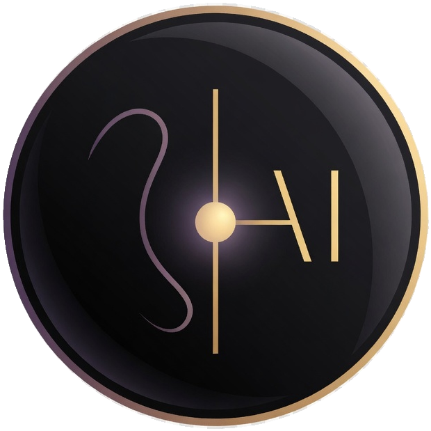

# Proyectos públicos

Estos son proyectos del ecosistema que pueden presentarse en público. Aquí solo se describe qué son, no cómo funcionan por dentro.

## Graphy

Graphy es el explorador inmersivo público del Will-AI Project Lab. Es la cara visible del universo WAIPL: un mapa que un visitante puede recorrer sin entrar en el interior del laboratorio.

## Will App

Will App es una aplicación de acompañamiento e información no directiva. Está pensada para acompañar la toma de decisiones en contextos de salud afectivo-sexual, sin prevenir, corregir ni dirigir conductas.

Ofrece un espacio seguro, inmediato y no moralista donde la persona puede consultar, reflexionar y decidir con mayor claridad. Su lema de origen es: «Estate presente en tu presente» (William Mejías Navarro).

No es una herramienta de diagnóstico ni de prescripción.

## Academia Vértigo's

Vértigo's es un proyecto de academia de arte y música asociado al laboratorio, con presencia en San Felipe (Yaracuy). Forma parte de la proyección pública del ecosistema en el ámbito educativo-musical.
